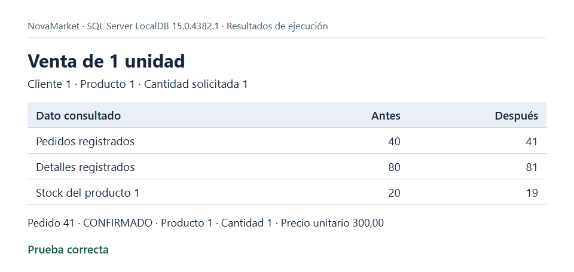
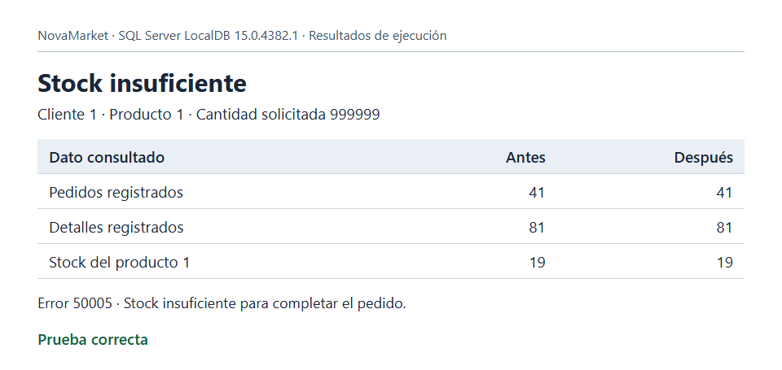

# Actividad 4. Pruebas comparativas y argumentación

En NovaMarket, cada venta debe generar un pedido, registrar el producto vendido y descontar del inventario la cantidad entregada. Se probó el procedimiento `dbo.sp_RegistrarPedido` con dos solicitudes consecutivas del cliente 1 para el producto 1.

| Solicitud | Pedidos antes → después | Detalles antes → después | Stock antes → después | Resultado observado |
|---|---|---|---|---|
| 1 unidad | 40 → 41 | 80 → 81 | 20 → 19 | Pedido 41 confirmado |
| 999999 unidades | 41 → 41 | 81 → 81 | 19 → 19 | Transacción cancelada por stock insuficiente (error 50005) |

## Venta confirmada

El pedido 41 quedó asociado al cliente 1. Su detalle registró una unidad del producto 1 a 300,00. La diferencia de una unidad entre el stock inicial y el final coincide con la cantidad del detalle.

## Venta rechazada

Tras la primera venta quedaban 19 unidades. Al solicitar 999999, el procedimiento detectó la falta de stock dentro de la transacción y ejecutó `ROLLBACK`. El último pedido siguió siendo el 41 y el producto conservó sus 19 unidades.

## Conclusión

El pedido, su detalle y el descuento de stock describen una misma venta. Confirmarlos juntos impide que una parte quede registrada por separado. La segunda prueba verificó tanto el error 50005 como el estado de las tres tablas. Así se distingue un rechazo por falta de existencias de otro fallo que también podría dejar iguales los totales.

## Reproducir las pruebas

En una instancia de SQL Server, crear una base de pruebas llamada `NovaMarket` y cargar en ella el [esquema y los datos iniciales](../00_esquema_y_datos_base.sql). En una sesión nueva, ejecutar [Pruebas.sql](Pruebas.sql) completo. El último resultado muestra la matriz de ambas operaciones. Cada ejecución confirma una venta, por lo que los valores de las capturas corresponden a la primera ejecución sobre los datos iniciales.
