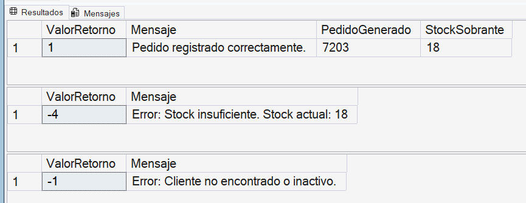

# PA3 - Programación Avanzada de Base de Datos

## Caso: NovaMarket

**Integrantes:**

- [Nombre Completo 1] - Actividad 1
- **Mauricio Rojas Arias** - Actividad 2 - [@chunchope](https://github.com/chunchope) - Desarrollo de Procedimiento Almacenado, control de parámetros OUTPUT y valores RETURN.
- [Nombre Completo 3] - Actividad 3
- Anthony Fernando Alcántara Valencia - Actividad 4
- [Victor Daniel aguilar de la cruz] Documentación

---

## Descripción del Proyecto

El presente trabajo aborda la problemática de una organización (NovaMarket) que necesita administrar clientes, productos y pedidos de manera segura. Para evitar inconsistencias en el inventario y centralizar las reglas del negocio, se desarrolló una solución en Microsoft SQL Server utilizando procedimientos almacenados y transacciones explícitas.

## Objetivo

Automatizar el registro de pedidos y la validación de stock del lado del servidor, asegurando que múltiples operaciones (insertar pedido, insertar detalle y descontar stock) se ejecuten como una sola unidad lógica de trabajo (atómica), evitando dejar datos huérfanos o parciales.

---

## Actividad 1 - Identificación del proceso a automatizar

El proceso seleccionado es el registro de pedidos y la validación de stock. Consiste en recibir los datos del pedido, validar que el cliente y el producto existan, comprobar que la cantidad solicitada sea válida y verificar que exista stock suficiente.

Si las validaciones son correctas, el pedido puede continuar con su registro y la actualización del stock correspondiente. La automatización de este proceso en SQL Server permite centralizar la lógica y evitar repetir las mismas validaciones desde diferentes aplicaciones cliente.

**Entradas del proceso:** ClienteID, ProductoID, Cantidad, Canal, FechaPedido.
**Salidas esperadas:** Identificador del pedido, confirmación del registro, stock restante o mensaje de error.
**Archivo desarrollado:** `01_actividad1_proceso.sql`

---

## Actividad 2 - Procedimientos almacenados de mantenimiento

**Estrategia y Decisiones Adoptadas:**
En base al pseudocódigo de la Actividad 1, el equipo de QA implementó un **Procedimiento Almacenado de Mantenimiento (`usp_RegistrarPedido`)**. Se tomó la decisión de utilizar parámetros de distintos tipos para asegurar una correcta comunicación con el cliente, tal como dicta la sesión 9 del sílabo.

- **Parámetros de Entrada (`INPUT`):** `@ClienteID, @ProductoID, @Cantidad, @Canal, @FechaPedido`. Permiten que la aplicación cliente envíe los datos de la transacción.
- **Parámetros de Salida (`OUTPUT`):** `@NuevoPedidoID, @StockRestante, @Mensaje`. En lugar de retornar tablas completas, se devuelve únicamente la confirmación y los IDs requeridos. Esto ahorra memoria RAM en el servidor y ancho de banda en la red.
- **Valor de Retorno (`RETURN`):** Se devuelve `1` si el proceso finaliza con éxito. Si ocurre un fallo en alguna regla de negocio (ej. falta de stock), se devuelve código de error negativo (`-1, -2, -3, -4`). Esto permite que la aplicación cliente evalúe si la operación falló o no con un simple condicional lógico sin leer cadenas de texto.

> **🖼️ ACTIVIDAD 2 (Procedimientos almacenados de mantenimiento):**  
> 

---

## Actividad 3 - Diseño de una operación transaccional

Para garantizar la integridad de los datos, se implementó el procedimiento almacenado `sp_RegistrarPedido`. Este script integra una **transacción explícita** (`BEGIN TRANSACTION` / `COMMIT` / `ROLLBACK`) junto con un bloque `TRY...CATCH`.

**Lógica implementada:**

1. Valida la existencia y estado del cliente.
2. Valida el stock del producto (usando `UPDLOCK` para evitar conflictos de concurrencia).
3. Si todo es correcto, inserta la cabecera en `Pedido`, el detalle en `DetallePedido` y actualiza el `Stock` del `Producto`.
4. Si ocurre cualquier error, el bloque `CATCH` ejecuta un `ROLLBACK` para deshacer todos los cambios y registra el error en una tabla de auditoría.

**Diferencia de transacciones:**

- **Implícitas:** No nos daban control sobre el error; si fallaba el paso 2, el paso 1 ya se había guardado.
- **Autoconfirmación (Auto-commit):** Es el comportamiento por defecto de SQL Server, donde cada sentencia se guarda de inmediato, lo cual es peligroso para operaciones múltiples.
- **Explícitas:** Utilizadas en nuestra solución, nos permiten agrupar operaciones y cancelar todo si una falla.

**Archivo desarrollado:** `003_Actividad3_Transacciones.sql` (o `004_Actividad4.sql` según la estructura final).

---

### Actividad 4 - Pruebas comparativas y argumentación

**Responsable:** Anthony Fernando Alcántara Valencia

Para esta actividad se desarrolló un script de pruebas robusto (`004_Actividad4.sql`) que no solo ejecuta las transacciones, sino que también implementa una tabla de auditoría (`ErrorProceso`), funciones para calcular precios y detalles, y una matriz comparativa automática. Esto garantiza que las pruebas no sean solo visuales, sino verificables mediante código.

#### Escenario 1: Confirmación de la Transacción (COMMIT)

- **Acción:** Se ejecutó el procedimiento `sp_RegistrarPedido` para vender 1 unidad del producto 1 al cliente 1.
- **Resultado:** El sistema validó el stock (20 unidades), registró el pedido (ID 41), insertó el detalle y descontó la unidad.
- **Evidencia:** El script arroja una matriz comparativa donde se observa que los pedidos pasaron de 40 a 41, los detalles de 80 a 81 y el stock del producto 1 bajó de 20 a 19. El estado del pedido quedó como 'CONFIRMADO'.
- **Captura:**
  ``

#### Escenario 2: Cancelación de la Transacción (ROLLBACK)

- **Acción:** Se intentó registrar un pedido de 999,999 unidades del mismo producto.
- **Resultado:** El procedimiento capturó el error mediante el bloque `TRY...CATCH`, realizó el `ROLLBACK` y registró el incidente en la tabla `ErrorProceso`. La matriz de pruebas demuestra que, tras el fallo, las cantidades de pedidos y detalles no cambiaron, y el stock se mantuvo intacto (en 19).
- **Evidencia:** El script captura específicamente el **Error 50005** (Stock insuficiente). Si el error fuera otro, la prueba se marcaría como inválida. La matriz final indica que el rechazo fue "CORRECTA".
- **Captura:**
  ``

#### Argumentación y Conclusiones

El script de pruebas demuestra la atomicidad de la transacción. En el caso de éxito, la cabecera (`Pedido`), el detalle (`DetallePedido`) y la salida de almacén (`Producto.Stock`) representan la misma operación lógica.

En el caso de rechazo por stock, SQL Server cancela la operación antes de insertar la cabecera, evitando dejar "pedidos fantasma". Además, la implementación del bloque `CATCH` que alimenta la tabla `ErrorProceso` proporciona una capa de auditoría muy valiosa para la organización, permitiendo rastrear cualquier intento fallido de venta.

**Archivo desarrollado:** `004_Actividad4.sql`

---

## Cómo ejecutar o revisar el proyecto

Para replicar las pruebas en SQL Server, siga este orden:

1. Ejecutar el archivo `00_esquema_y_datos_base.sql` para crear las tablas y poblar la base de datos.
2. Ejecutar el archivo `004_Actividad4.sql` (el cual contiene la creación de los procedimientos, funciones y la ejecución de las pruebas).
3. Revisar los mensajes de la consola y la matriz final generada.

## Evidencias y Video

- **Carpeta de evidencias:** Las capturas de pantalla de las pruebas se encuentran en la carpeta `004_Actividad4/` de este repositorio.
- **Video público de YouTube:** [PEGAR AQUÍ EL ENLACE DEL VIDEO]
